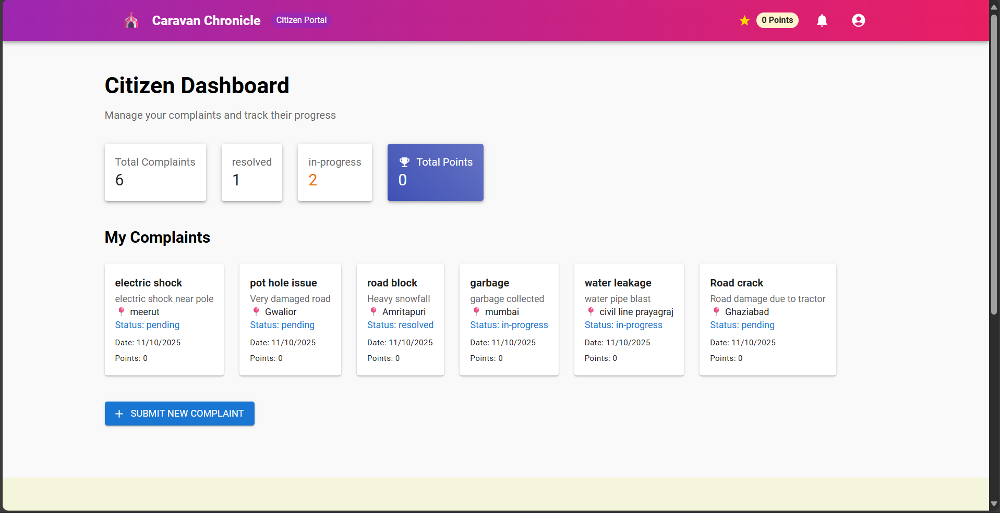
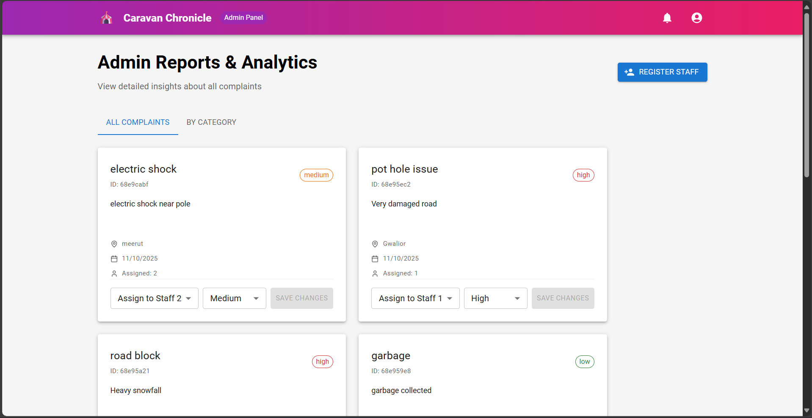
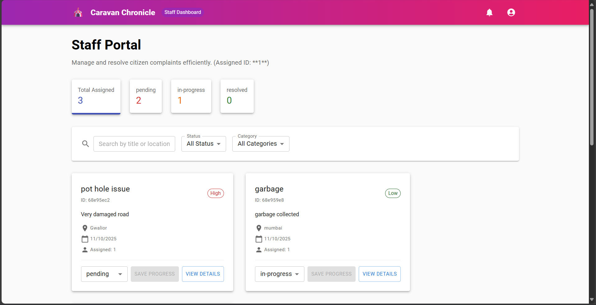

# 🏙️ Clean City Complaint System

A **full-stack civic complaint management platform (MERN Stack)** designed to streamline how citizens report, track, and resolve local community issues such as road damage, sanitation, and water leaks.

---

## 🧭 How to Use

### 👤 Citizen
- Register and log in as a citizen.
- Submit complaints with title, category, description, and photo.
- Track your complaint status in the dashboard.

### 🧑‍🔧 Staff
- Log in using staff credentials.
- View assigned complaints and mark them as **In-Progress** or **Resolved**.

### 🧑‍💼 Admin
- Manage all users and complaints.
- Assign complaints to staff and monitor city-wide issues.

---

## 🌟 Key Features

✅ **User Authentication** – Secure registration and login using session-based authentication.  
👥 **Role-Based Access Control** – Different dashboards and permissions for **Citizen**, **Staff**, and **Admin** roles.  
📝 **Complaint Submission** – Citizens can file complaints with **description, location, and photo evidence**.  
📊 **Real-time Status Tracking** – Complaints progress through stages: _Pending → In-Progress → Resolved_.  
📸 **Photo Uploads** – Integrated with **Cloudinary** for secure image storage.  
🛡️ **Security & Privacy** – Managed using **express-session**, **dotenv**, and **CORS**.  

---

## 🧩 Technology Stack

| Component | Technology | Role |
|------------|-------------|------|
| **Frontend** | React.js, Material UI (MUI) | Responsive UI for dashboards and complaint submission |
| **Backend** | Node.js, Express.js | RESTful API for routes, authentication, and logic |
| **Database** | MongoDB, Mongoose | NoSQL database for flexible complaint and user data |
| **File Storage** | Cloudinary | Cloud-based image storage |
| **Middleware** | Multer | Handles multipart form data (images before upload) |
| **Security** | Express-session, CORS | Session management and cross-origin access control |

---

## 🎥 Project Overview

Here’s a quick look at the Clean City Complaint System in action:

| Citizen Dashboard | Complaint Form | Admin Dashboard |
|-------------------|----------------|-----------------|
|  |  |  |

---

## 🛠️ Local Development Setup

### 1. Prerequisites
Before you begin, ensure you have:

- [Node.js](https://nodejs.org/en/download/) (v16+ recommended)
- [MongoDB Atlas Account](https://www.mongodb.com/cloud/atlas)
- [Cloudinary Account](https://cloudinary.com/)

---

### 2. Backend Setup (`/backend`)

```bash
# Navigate to the backend folder
cd backend

# Install required dependencies
npm install


## ⚡ Available Scripts

### Backend
```bash
cd backend
npm run dev


## 🚀 Future Enhancements
- 📱 Add mobile-friendly complaint submission app (React Native)
- 🗺️ Integrate Google Maps API for live location marking
- 🔔 Real-time notifications via email/SMS
- 🧾 Complaint analytics dashboard for admins


## 💖 Acknowledgements
- [Cloudinary](https://cloudinary.com/) – for image storage
- [MongoDB Atlas](https://www.mongodb.com/atlas) – for cloud database
- [Material UI](https://mui.com/) – for elegant UI components
- Special thanks to **Ashmit Gupta** for backend collaboration


